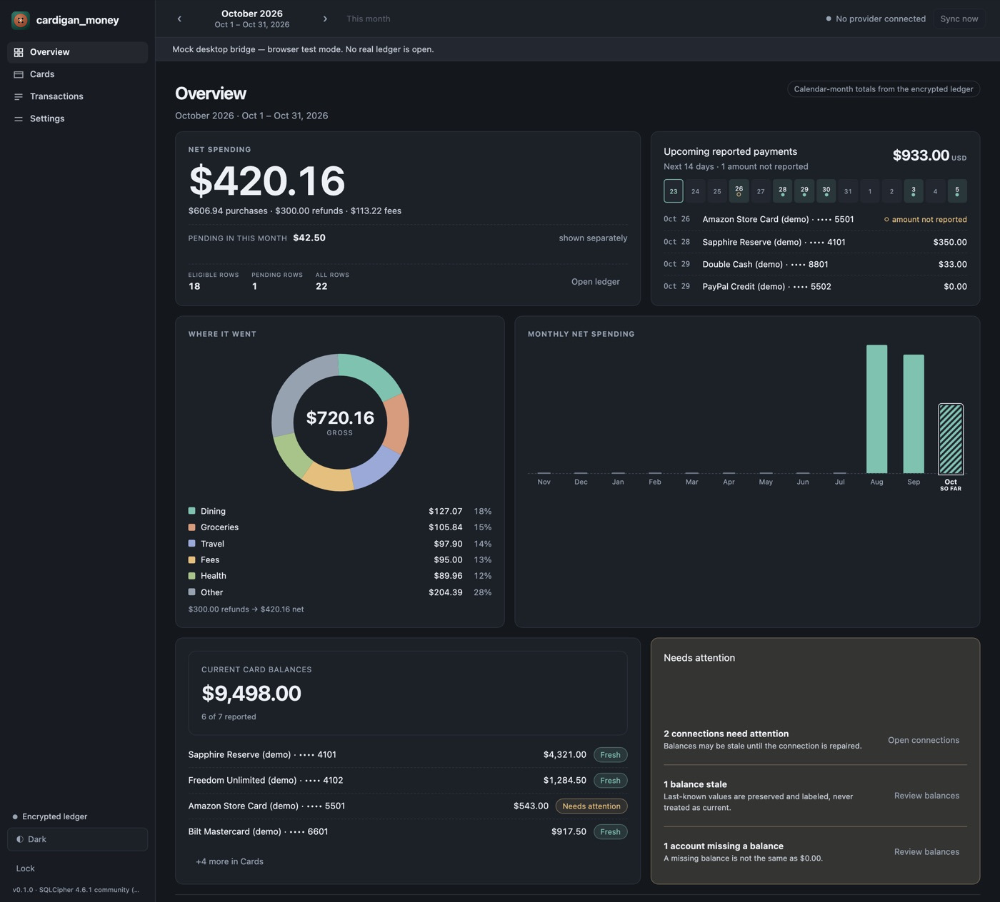

A local-first, encrypted personal finance app for macOS. It tracks one person's credit-card
balances and calendar-month spending, and keeps everything on the Mac — no account, no cloud,
no telemetry.

Built with Tauri 2, React, TypeScript, Rust, and SQLCipher.



## What it does

- Calendar-month spending, kept separate from statement cycles.
- Card balances and upcoming payments that stay current regardless of the month you're viewing.
- Pending, posted, refunds, fees, payments, and transfers are distinct states.
- An encrypted ledger, unlocked with a passphrase typed into a native macOS sheet.
- Works offline with demo data or CSV import; optional Plaid **Sandbox** or **Trial/Production** connection for sync.
- One active Plaid Item per institution. A duplicate link is refused before Plaid is asked for an access token, and **Update**/**Reconnect** reuses the existing Item, so accidents cannot spend Trial Item capacity.

## Requirements

- macOS 13 or newer (developed and tested on Apple Silicon)
- Xcode Command Line Tools: `xcode-select --install`
- Rust stable via [rustup](https://rustup.rs)
- Node.js 22.12+ and pnpm 12 (`corepack enable` or `npm install -g pnpm`)
- Nothing else: SQLCipher is compiled in from the vendored crate

## Run it

```bash
git clone https://github.com/awychoi/cardigan_money.git
cd cardigan_money
pnpm install --frozen-lockfile
pnpm tauri dev
```

The first Rust build takes a few minutes; later launches are fast. The app opens locked: create a
vault with a passphrase, or choose **Open demo (synthetic data)** to look around without one.

Browser-only UI preview with mock data (no Rust, no real ledger):

```bash
VITE_MOCK_BRIDGE=1 pnpm dev
```

## Build a macOS app

```bash
pnpm tauri build
open src-tauri/target/release/bundle/macos/cardigan_money.app
```

The build is ad-hoc signed for local use only — not notarized, not App Sandboxed, not a
distributable release. If macOS complains about the signature, re-sign it locally:

```bash
codesign --force --deep --sign - src-tauri/target/release/bundle/macos/cardigan_money.app
```

## Tests

```bash
pnpm verify          # typecheck, lint, unit tests, production build
pnpm test:e2e        # Playwright; run `pnpm exec playwright install chromium` first
cd src-tauri && cargo test
```

## Security notes

- **There is no passphrase recovery.** Lose the passphrase and every backup passphrase, and the
  data is unrecoverable.
- The ledger is encrypted at rest with SQLCipher; backups are encrypted containers. Plaintext CSV
  exports are not protected — the app warns before writing one.
- Plaid supports **Sandbox** test Items and **Trial/Production** real Items with separate
  credentials. The app allows one active Item per institution: if a bank is already connected, link
  completion stops before the access-token exchange and points to **Update**/**Reconnect** instead,
  so a duplicate cannot consume another Trial Item. Trial/Production linking is implemented but has
  not been verified with a real Item; Trial limits and billing apply. The app is not affiliated with
  Plaid.
- The UI never receives the passphrase or provider tokens; those stay in Rust and the macOS
  Keychain.
- Read [SECURITY.md](SECURITY.md) before relying on this for real data.

## Project layout

| Path | Contents |
| --- | --- |
| `src/` | React UI, themes, mock bridge |
| `src-tauri/` | Rust backend: vault, storage, providers, security |
| `src-tauri/migrations/` | SQL schema |
| `e2e/` | Playwright tests |
| `docs/` | Design, security, operations, and reference docs |

## Docs

- [Documentation map](docs/README.md)
- [Security architecture](docs/security/architecture.md) · [threat model](docs/security/threat-model.md)
- [Backup and recovery](docs/operations/backup-recovery.md)
- [Plaid integration notes](docs/integrations/plaid-guide.md)
- [Implementation status](docs/reference/implementation-status.md)

## Status

Early and experimental. Interfaces, storage formats, and behavior can change. Only Plaid Sandbox
linking has been verified; Trial/Production wiring is present but a real Item has not been
verified. The macOS build is ad-hoc signed and not distribution-ready.

## License

Copyright (c) 2026 awychoi.

[PolyForm Noncommercial 1.0.0](LICENSE) — free to use, modify, and share for any noncommercial
purpose: personal projects, study, research, hobby use, and nonprofit, educational, or government
work. Commercial use is not permitted.

The software is provided **as is, without warranty or condition of any kind**, and you use it
**at your own risk**. The author is not liable for any damages arising from its use, including
lost data, forgotten passphrases, or incorrect financial figures. Keep your own backups.

## About this project

This is a fun experimental agentic AI workflow project. It will keep being worked on and
experimented with — expect rough edges, changing directions, and new ideas over time.
