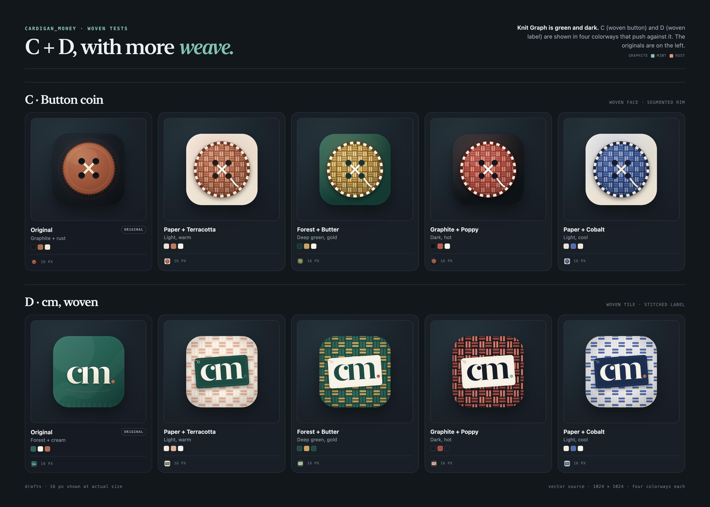
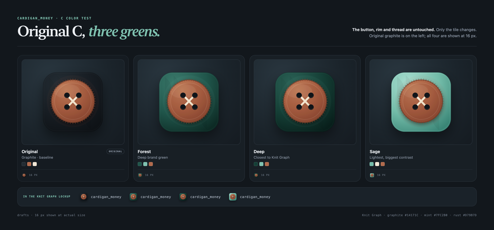
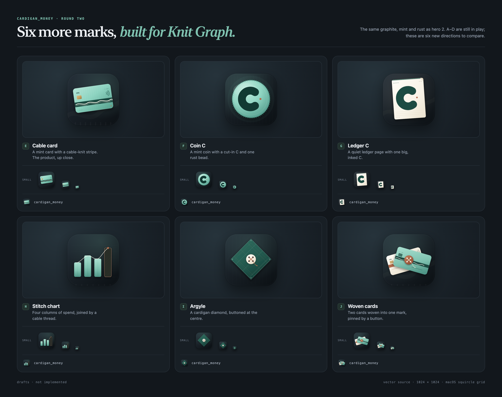
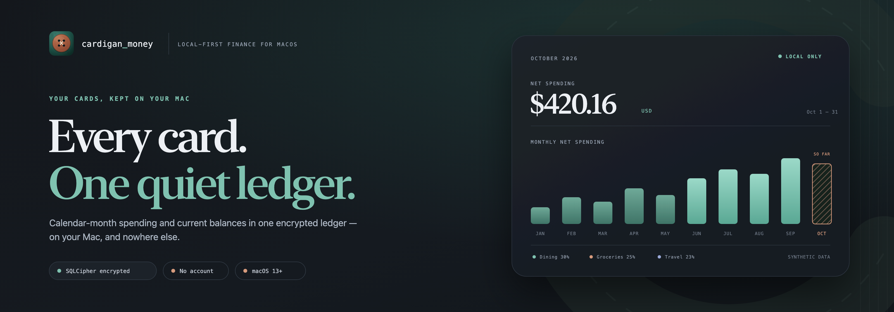
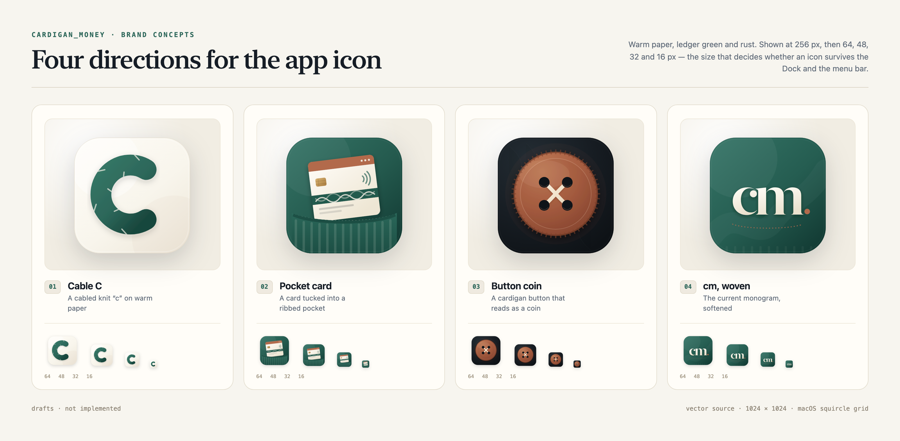

# Brand directions — chosen

**Chosen and installed (25 Oct 2026): Forest C + Knit Graph.**

The original C button on the Forest green tile — [`19-c-green-forest.svg`](icons/19-c-green-forest.svg) —
is now the app mark in every theme, the vault and boot screens, the generated Tauri icon set and
the [Knit Graph hero](hero/h2-knit-graph.svg). The repository README uses the Knit Graph banner.

The rest of this page is the exploration that led there; the colorway comparisons remain as the
design record.

## Round three · the woven exploration

**Hero 2, Knit Graph, is chosen.** Round three keeps **C · Button coin** and **D · cm, woven**, but
makes the woven material the point:

- **C** gets a woven basket face and a segmented woven rim — still a button, still four holes and
  an X of thread.
- **D** becomes a woven tile with the `cm` on a stitched garment label, complete with a grommet and
  a loose thread.

Each is shown in four colorways that push against the dark green header. The originals are on the
left of the board.



## Round three · colorway comparisons
| Colorway | C · Button coin | D · cm, woven | Contrast against Knit Graph |
| --- | --- | --- | --- |
| **Paper + Terracotta** | [C SVG](icons/11-c-woven-paper-terracotta.svg) | [D SVG](icons/15-d-woven-paper-terracotta.svg) | Light and warm; the strongest pop on the dark header. |
| **Forest + Butter** | [C SVG](icons/12-c-woven-forest-butter.svg) | [D SVG](icons/16-d-woven-forest-butter.svg) | Gold on green; the most integrated with the brand. |
| **Graphite + Poppy** | [C SVG](icons/13-c-woven-graphite-poppy.svg) | [D SVG](icons/17-d-woven-graphite-poppy.svg) | Dark and hot; the boldest of the four. |
| **Paper + Cobalt** | [C SVG](icons/14-c-woven-paper-cobalt.svg) | [D SVG](icons/18-d-woven-paper-cobalt.svg) | Light and cool; the outlier. |

**My picks:** **C · Paper + Terracotta** for maximum contrast in the Dock and the hero lockup, or
**D · Forest + Butter** if you want the icon to feel like it was made from the same cloth as the
header. **D · Paper + Terracotta** is the warmer label version.

All eight variants are 1024 × 1024, path-based, on the same 824 px tile. The board shows 16 px at
actual size.

### Also tested — original C on green



The original rust button, reeded rim and cream thread are untouched; only the tile is recolored.
**Forest** is the chosen tile, **Deep** is closest to the header, and **Sage** is the biggest
contrast.

[Forest](icons/19-c-green-forest.svg) · [Deep](icons/20-c-green-deep.svg) · [Sage](icons/21-c-green-sage.svg)

**In the app:** the four marks at the 26 px brand position across Ledger, Graphite and Editorial,
light and dark — [theme-demo.png](preview/theme-demo.png). The Demo pill is hidden so the mark
holds its normal size.

---

## Previously — round two

The six round-two icons (E–J) are still available; `F + 2` and `E + 2` remain the strongest new
shapes if the woven C/D treatment is not the direction.



### Round-two shortlist

| Pair | Icon | Why it works with Knit Graph |
| --- | --- | --- |
| **F + 2** ★ | **Coin C** | A mint coin, a cut-in C and one rust bead. The most legible new mark at 16 px. |
| **E + 2** | **Cable card** | The product, up close. Choose this if the app should read as a card app before it reads as a coin. |
| **H + 2** | **Stitch chart** | The most literal match for the hero: four columns, a cable thread and a hatched current month. |
| **C + 2** | **Button coin** | The original tactile favorite, unchanged. Rust button, graphite tile; still a strong fit. |
| **G + 2** | **Ledger C** | The quiet ledger. The calmest of the new six and the least likely to date. |
| **J + 2** | **Woven cards** | The most story-driven; two cards pinned by a button. The busiest of the set at 16 px. |

---

## The chosen header



Graphite `#14171C`, mint `#7FC2B0`, rust `#D79B7D`, the mono `cardigan_money` wordmark, and a
synthetic-data label. 1600 × 560, built to be readable at README width and in dark mode.

[Open the hero SVG](hero/h2-knit-graph.svg)

---

## The six new icons

All six are 1024 × 1024 SVG on an 824 px rounded tile with a 100 px margin. They use the same
palette as the chosen hero, so the mark and the header feel like one system.

### E · Cable card

A mint card on graphite with a deep-green cable braid across the middle, a chip, contactless
marks and the `cm` wordmark. The most product-forward of the six and the easiest to explain.

- **At 16 px:** a mint card with a dark band; still reads as a card.
- **Pairs with:** Knit Graph, obviously. Also Quiet Ledger if the hero ever changes.

[SVG](icons/05-cable-card.svg)

### F · Coin C

A mint coin with a reeded edge, a stitched inner ring, a large dark C and a rust bead at the
opening. It is the cardigan button, a coin, and the first letter of the name in one object.

- **At 16 px:** the strongest of the ten; the C survives when the details disappear.
- **Pairs with:** Knit Graph. This is my pick.

[SVG](icons/06-coin-c.svg)

### G · Ledger C

A cream ledger page with a green top rule, a folded corner, a stitched border, ledger lines and
one big inked C. The most "quiet ledger" of the six.

- **At 16 px:** a pale page with a dark C. Calm, but less loud in the Dock.
- **Pairs with:** Knit Graph, especially if the README keeps the light Quiet Ledger as well.

[SVG](icons/07-ledger-c.svg)

### H · Stitch chart

Four mint columns of spend, joined by a cream cable thread and finished with a hatched "so far"
column and a rust data point. The most literal translation of the chosen hero into an icon.

- **At 16 px:** reads as a small bar chart; the rust current month is the last thing to go.
- **Pairs with:** Knit Graph. The risk is that it reads as a generic analytics app from a
  distance.

[SVG](icons/08-stitch-chart.svg)

### I · Argyle

A deep-green diamond with a faint argyle plaid, a stitched inset border and a cream button at the
centre. The most pattern-led direction; it leans into the cardigan rather than the money.

- **At 16 px:** a diamond with a light dot. Distinctive, but the least literal of the ten.
- **Pairs with:** Knit Graph, if you want the brand to feel more textile than finance.

[SVG](icons/09-argyle.svg)

### J · Woven cards

A cream card and a mint card crossed and pinned by a rust button with a loose thread. It reads as
a card stack, a clasp or a small wallet, depending on the size.

- **At 16 px:** the busiest of the six; the two cards blur into one light shape.
- **Pairs with:** Knit Graph, if you want a warmer, more illustrated app icon.

[SVG](icons/10-woven-cards.svg)

---

## Round one — still available

The original four are unchanged. The full visual board is in [index.html](index.html), and the
contact sheet is [preview/icons.png](preview/icons.png).



| Key | Icon | One-liner |
| --- | --- | --- |
| A | [Cable C](icons/01-cable-c.svg) | A knit letterform on warm paper. |
| B | [Pocket card](icons/02-pocket-card.svg) | A card tucked into a ribbed pocket. |
| C | [Button coin](icons/03-button-coin.svg) | A reeded rust button/coin on graphite. |
| D | [cm, woven](icons/04-cm-weave.svg) | The current monogram, softened and outlined. |

Heroes 1 [Quiet Ledger](hero/h1-quiet-ledger.svg) and 3 [Wallet](hero/h3-wallet.svg) are also
still in the folder. Round two assumes hero 2 is the header; the icons can still be paired with
the light or warm heroes later.

---

## Production notes

- **Grid.** Every icon is a 1024 × 1024 SVG with the artwork on an 824 px rounded tile and a
  100 px margin, close to Apple's macOS icon grid.
- **Paths vs. text.** A–D are path-based; D's monogram is outlined. E, G and J contain tiny live
  system text (`cm.`, card digits, micro labels). At 16 px that text is invisible anyway, so it
  can be removed or outlined before the final `.icns`. The eight round-three C/D variants are
  path-only; the `cm` on the D label reuses the outlined monogram.
- **Honesty.** The cards use `cm.` and synthetic last-four digits, never issuer trademarks. The
  dark hero panel is labelled `SYNTHETIC DATA`.
- **Hero type.** The hero SVGs use New York, SF Pro and SF Mono as live text. The 2× PNG previews
  are the reliable share asset; outline the wordmark and copy before publishing an SVG to GitHub.

### Installing the chosen icon

1. Export the chosen SVG to a 1024 px PNG (or feed the SVG to `tauri icon` if your version accepts
   it).
2. Run `pnpm tauri icon path/to/1024.png` to regenerate `src-tauri/icons`.
3. Check the Dock and menu bar at 16 and 32 px before committing the change.
4. Replace the `cm` chip in `AppShell` and the vault gate with the chosen vector mark, then reuse
   it for the favicon and About panel.
5. Use the 2× `preview/h2-knit-graph.png` as the README hero.

---

## Files

| Path | What |
| --- | --- |
| [`icons/11-c-woven-paper-terracotta.svg`](icons/11-c-woven-paper-terracotta.svg) | C · woven button, paper + terracotta |
| [`icons/12-c-woven-forest-butter.svg`](icons/12-c-woven-forest-butter.svg) | C · woven button, forest + butter |
| [`icons/13-c-woven-graphite-poppy.svg`](icons/13-c-woven-graphite-poppy.svg) | C · woven button, graphite + poppy |
| [`icons/14-c-woven-paper-cobalt.svg`](icons/14-c-woven-paper-cobalt.svg) | C · woven button, paper + cobalt |
| [`icons/15-d-woven-paper-terracotta.svg`](icons/15-d-woven-paper-terracotta.svg) | D · woven label, paper + terracotta |
| [`icons/16-d-woven-forest-butter.svg`](icons/16-d-woven-forest-butter.svg) | D · woven label, forest + butter |
| [`icons/17-d-woven-graphite-poppy.svg`](icons/17-d-woven-graphite-poppy.svg) | D · woven label, graphite + poppy |
| [`icons/18-d-woven-paper-cobalt.svg`](icons/18-d-woven-paper-cobalt.svg) | D · woven label, paper + cobalt |
| [`icons/19-c-green-forest.svg`](icons/19-c-green-forest.svg) | original C · forest green tile |
| [`icons/20-c-green-deep.svg`](icons/20-c-green-deep.svg) | original C · deep green tile |
| [`icons/21-c-green-sage.svg`](icons/21-c-green-sage.svg) | original C · sage green tile |
| [`icons/05-cable-card.svg`](icons/05-cable-card.svg) | E · mint card with a cable stripe |
| [`icons/06-coin-c.svg`](icons/06-coin-c.svg) | F · mint coin with a C |
| [`icons/07-ledger-c.svg`](icons/07-ledger-c.svg) | G · cream ledger page with a C |
| [`icons/08-stitch-chart.svg`](icons/08-stitch-chart.svg) | H · bar chart + cable thread |
| [`icons/09-argyle.svg`](icons/09-argyle.svg) | I · argyle diamond + button |
| [`icons/10-woven-cards.svg`](icons/10-woven-cards.svg) | J · crossed cards + button |
| [`icons/01-cable-c.svg`](icons/01-cable-c.svg) … [`04-cm-weave.svg`](icons/04-cm-weave.svg) | A–D · round one |
| [`hero/h2-knit-graph.svg`](hero/h2-knit-graph.svg) | chosen hero · vector |
| [`hero/h1-quiet-ledger.svg`](hero/h1-quiet-ledger.svg) | alternate hero · vector |
| [`hero/h3-wallet.svg`](hero/h3-wallet.svg) | alternate hero · vector |
| [`preview/woven-variants.png`](preview/woven-variants.png) | round-three woven C/D board |
| [`preview/c-green.png`](preview/c-green.png) | original C on three greens |
| [`preview/theme-demo.png`](preview/theme-demo.png) | four C marks in the app shell, all themes/modes |
| [`preview/icons-round2.png`](preview/icons-round2.png) | round-two contact sheet |
| [`preview/icons.png`](preview/icons.png) | round-one contact sheet |
| [`preview/h2-knit-graph.png`](preview/h2-knit-graph.png) | chosen hero · 2× preview |
| [`preview/h1-quiet-ledger.png`](preview/h1-quiet-ledger.png) | alternate hero · 2× preview |
| [`preview/h3-wallet.png`](preview/h3-wallet.png) | alternate hero · 2× preview |
| [`index.html`](index.html) | local gallery of the main icon and hero directions |
| [`render.mjs`](render.mjs) | preview regeneration script |
| [`build-woven.mjs`](build-woven.mjs) | builds the eight woven C/D SVGs and the round-three board |
| [`build-green.mjs`](build-green.mjs) | builds the three green-tile C SVGs and their board |
| [`capture-theme-demo.mjs`](capture-theme-demo.mjs) | captures the theme/mode demo from the running mock app |

### Regenerate the previews

```bash
node docs/design/brand/render.mjs
```

The woven C/D files and the green C tiles are generated separately:

```bash
node docs/design/brand/build-woven.mjs
node docs/design/brand/build-green.mjs
```

The theme-demo board is captured from the running mock app:

```bash
VITE_MOCK_BRIDGE=1 VITE_MOCK_SCENARIO=demo pnpm dev
CHROMIUM_PATH="/Applications/Google Chrome.app/Contents/MacOS/Google Chrome" \
  node docs/design/brand/capture-theme-demo.mjs
```

Both scripts use the Playwright Chromium installed with the repo. If the local browser version
does not match the library, point `CHROMIUM_PATH` at a Chromium/Chrome binary:

```bash
CHROMIUM_PATH="/Applications/Google Chrome.app/Contents/MacOS/Google Chrome" \
  node docs/design/brand/build-woven.mjs
```

---

*Round three · October 2026 · synthetic numbers · no app code changed.*
