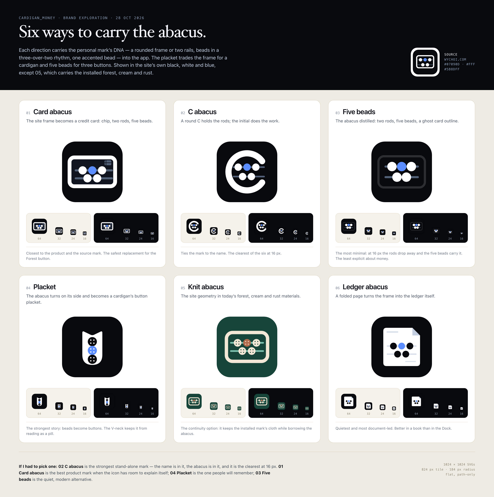
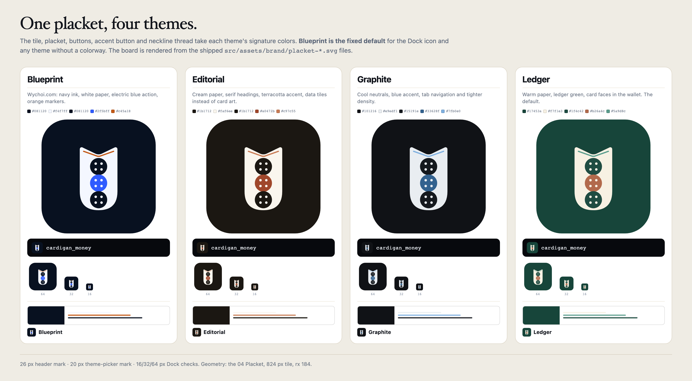
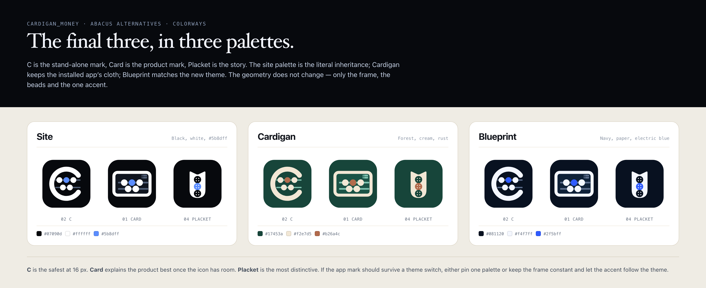

# Abacus directions — Placket chosen

**Chosen and installed (29 Oct 2026): 04 Placket**, with one colorway per theme. The installed
Forest button is replaced by the placket in the header, vault gate, onboarding and boot screen; the
Dock icon and any theme without a colorway use **Blueprint**, the fixed default.



Six directions carried the [wychoi.com](https://wychoi.com) abacus into cardigan_money. The source
is a 256 px raster: a `#07090d` rounded tile, a white rounded frame, slate rods, five white beads
(three over two), and one `#5b8dff` bead. It is flat, geometric, and already says “calculation” —
which is what a ledger is.

## Installed colorways



The geometry is fixed; five colors change per theme.

| Theme | Tile | Placket | Buttons | Accent button | Neckline thread |
| --- | --- | --- | --- | --- | --- |
| Blueprint (default) | `#081120` | `#f4f7ff` | `#081120` | `#2f5bff` | `#c45a18` |
| Editorial | `#1b1712` | `#faf6ee` | `#1b1712` | `#a0472b` | `#c97c55` |
| Graphite | `#101216` | `#e9edf1` | `#15191e` | `#33628f` | `#7fb0e0` |
| Ledger | `#17453a` | `#f7f1e3` | `#1f4c42` | `#b26a4c` | `#5a9d8c` |

- **Blueprint is the fixed default.** It is the Dock icon and the fallback when a theme has no
  colorway. The in-app mark follows the resolved `theme.id`; the theme picker shows each colorway
  at 20 px beside its name.
- **Assets and mapping.** `src/assets/brand/placket-<id>.svg` is generated by
  [`scripts/build-brand-marks.mjs`](../../../../scripts/build-brand-marks.mjs) and mapped by
  [`src/brand/marks.ts`](../../../../src/brand/marks.ts). The theming contract is in
  [3.8 Brand mark colorways](../../theming.md#38-brand-mark-colorways).
- **The thread** is the V-neck seam. It carries the theme's secondary color, is decorative, and
  disappears below about 32 px.

## The six

| # | Direction | What it does | At 16 px | Choose it if |
| --- | --- | --- | --- | --- |
| 01 | [Card abacus](icons/01-card-abacus.svg) | The frame becomes a credit card: 1.58 ratio, chip, two rods, five beads. | Card outline and beads, chip lost | The icon should explain the product before the brand. |
| 02 | [C abacus](icons/02-c-abacus.svg) | A round C holds the rods and beads. | **Strongest** — the C and blue bead survive | You want the name in the mark and the Dock to work. |
| 03 | [Five beads](icons/03-five-beads.svg) | The abacus distilled: two rods, five beads, a ghost card. | Beads and blue dot, rods fade | You want the quietest, most modern mark. |
| 04 | [Placket](icons/04-placket.svg) | The abacus turns on its side and becomes a cardigan placket: V-neck, three buttons. | White bar with three dots | You want the cardigan and the abacus to be one object. |
| 05 | [Knit abacus](icons/05-knit-abacus.svg) | The site geometry in today’s forest, cream and rust, with four-hole buttons. | Cream frame and one rust dot | The new mark must sit beside the installed brand. |
| 06 | [Ledger abacus](icons/06-ledger-abacus.svg) | A folded page turns the frame into the ledger itself. | White page with dots | The mark should feel like a document, not an app. |

**Why the Placket.** The C was the clearest at 16 px and the Card was the best product mark; the
Placket traded a little 16 px clarity for the strongest story and the most colorable form. At the
26 px header slot it reads as a garment tag, and its three buttons carry the theme accent cleanly.

## Exploration colorways



The site palette is the literal inheritance. **Cardigan** keeps the installed forest, cream and
rust. **Blueprint** matches the theme added on 28 Oct 2026. These were the exploration palettes;
the shipped set is the four-theme table above.

## Legibility

The board shows 64/32/24/16 px on light and dark strips. The measured result:

- **02 C** is the clearest at 16 px without the surrounding context.
- **01 Card** and **06 Ledger** need 32 px; at 16 px the chip and fold disappear but the silhouette
  and the blue bead hold.
- **03 Five beads** loses the rods at 16 px; the five beads become the mark.
- **04 Placket** survives as a white bar with three dots — distinctive, not self-explanatory.
- **05 Knit** survives because the frame is the thickest of the set.

## Files

| Path | What |
| --- | --- |
| [`source/wychoi-abacus-256.png`](source/wychoi-abacus-256.png) | The original site mark, 256 px |
| [`source/wychoi-abacus.svg`](source/wychoi-abacus.svg) | The same mark redrawn, tile-only viewBox |
| [`icons/`](icons) | Six 1024 px exploration candidates, path-only |
| [`icons/colorways/`](icons/colorways) | C, Card and Placket in site, cardigan and blueprint |
| [`build.mjs`](build.mjs) | Generates the exploration SVGs from the shared geometry |
| [`render.mjs`](render.mjs) | Renders `preview/board.png` and `preview/colorways.png` |
| [`render-theme-colorways.mjs`](render-theme-colorways.mjs) | Renders `preview/theme-colorways.png` from the shipped app assets |

The exploration icons are 1024 × 1024 with the artwork on an 824 px tile (`rx 184`), matching the
rest of the brand. They are flat and path-only: no filters, gradients, or live text.

```bash
node docs/design/brand/abacus/build.mjs
node docs/design/brand/abacus/render.mjs
node docs/design/brand/abacus/render-theme-colorways.mjs
```

## Installed implementation

1. [`scripts/build-brand-marks.mjs`](../../../../scripts/build-brand-marks.mjs) generates
   `src/assets/brand/placket-<id>.svg` plus the 1024 px
   `placket-blueprint-icon.svg`. It refuses to run if a bundled theme has no palette.
2. [`src/brand/marks.ts`](../../../../src/brand/marks.ts) maps theme ids to the assets and falls back
   to Blueprint. [`src/brand/marks.test.ts`](../../../../src/brand/marks.test.ts) enforces one colorway
   per theme.
3. `BrandMark` receives the active `theme.id` and sets `data-brand-theme`; the theme picker renders
   every colorway by name.
4. The Tauri icon set was generated from the Blueprint placket:
   `pnpm tauri icon src/assets/brand/placket-blueprint-icon.svg`.
5. Check the Dock, the 26 px header slot, the vault gate, and the boot screen at 16 and 32 px after
   any change.
